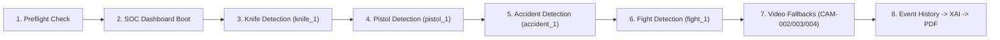

# AEGIS Smart Surveillance SOC — Live Demonstration Runbook

> **DEMO FREEZE NOTICE**: This system is locked and certified for presentation. No fine-tuning, training, or code restructuring is permitted during demonstration execution.

---

## 1. System Requirements & Architecture Overview

The AEGIS Smart Surveillance platform executes real-time multi-hazard threat intelligence across distributed camera feeds. The system orchestrates four computer vision models on CUDA:
- **Person Detection & Spatial Gating**: YOLO11s COCO (`conf >= 0.35`, qualified `conf >= 0.50`)
- **Weapon & Edged Object Detection**: Custom YOLO 6-Class (`pistol >= 0.45`, `knife >= 0.50`, Variant 3 bounding box ceiling)
- **Physical Altercation Classifier**: YOLO Fight Classifier (Temporal buffer 6/10 frames, 2+ person gating)
- **Vehicular Accident Detector**: YOLO11s Object Detection (`conf >= 0.70`, 2-frame persistence confirmation)

---

## 2. Exact Run Commands

> [!IMPORTANT]
> Always execute the backend **WITHOUT `--reload`** and strictly bound to `127.0.0.1` to ensure maximum FPS stability and prevent auto-reload file watcher overhead during inference.

### Terminal 1: Backend API & AI Engine
```powershell
cd "d:\AI SUrvellinace\backend"
python -m uvicorn app.main:app --host 127.0.0.1 --port 8000
```

### Terminal 2: Frontend Command Center
```powershell
cd "d:\AI SUrvellinace\frontend"
npm run preview -- --host 127.0.0.1 --port 5173
```
*(Alternative for dev mode: `npm run dev -- --host 127.0.0.1 --port 5173`)*

---

## 3. Demonstration Login Accounts

| Role | Username | Password | Email | Access Privileges |
| :--- | :--- | :--- | :--- | :--- |
| **Chief SOC Director (Super Admin)** | `admin` | `admin123` | `admin@company.com` | Full access: Live Monitoring, Model Sandbox, Forensic Search, Event History, Zone Editor, Email Dispatch |
| **Control Room Operator** | `operator` | `operator123` | `operator@company.com` | Operational access: Live Feeds, Incident Acknowledgment, Siren Silence, Event Timeline |
| **Police Admin** | `police` | `police123` | `police@company.com` | Law enforcement escalation view & evidence export |
| **Guest / Viewer** | `viewer` | `viewer123` | `viewer@company.com` | Read-only telemetry access |

---

## 4. Preflight Health Verification

Before starting the presentation, run the automated diagnostic preflight script to confirm system readiness:

```powershell
cd "d:\AI SUrvellinace\backend"
python demo_preflight.py
```

### Optional Clean Slate Reset:
If prior testing left leftover incident logs or temporary screenshots, run the preflight with the archive flag:
```powershell
python demo_preflight.py --clear-events
```
*When prompted, type `YES`. This safely moves existing media to `screenshots_old/` and `event_clips_old/`, and clears only the `events` collection. Users, camera configs, and zone polygons remain completely untouched.*

---

## 5. Live Demonstration Sequence



> [!CAUTION]
> **DEMO WARNINGS & CONSTRAINTS**:
> - **DO NOT USE `accident_3.jpg`**: It contains background clutter / vehicle wheel rim artifacts that can trigger an unattended pistol false alarm. Use `accident_1.jpg` (or `accident_2.jpg`).
> - **DO NOT HOLD `pistol_3.jpg` LONGER THAN 8 SECONDS**: Stationary tracking of the person in zone triggers `LOITERING DETECTED` after ~10 seconds (~150 frames). Present for 3–5 seconds and dismiss.

### Step 1: Preflight & System Diagnostics
1. Open PowerShell and run:
   ```powershell
   python backend/demo_preflight.py
   ```
2. Confirm to observers that all subsystems (MongoDB, 4 CUDA models, 5 seeded camera configurations, writable media directories, free network ports) report **PASS**.
3. Launch Terminal 1 (Backend on port 8000) and Terminal 2 (Frontend on port 5173 preview).

### Step 2: Operational Boot & SOC Dashboard
1. Open browser to `http://127.0.0.1:5173`.
2. Log in using Username: `admin` / Password: `admin123`.
3. Highlight the seeded camera grid and switch to **Live Monitoring** view (`CAM-001`).

### Step 3: Edged Weapon Demonstration (`knife_1.jpg`)
1. Display `demo_images/knife/knife_1.jpg` on mobile phone screen and hold it at chest height facing the webcam.
   - **Expected Result**:
     - System detects presenter (`conf >= 0.50`) and knife (`conf >= 0.50`).
     - Hits 3-frame temporal persistence.
     - Triggers `WEAPON DETECTED (Knife)` at **HIGH** threat level (Score: 65–75).
     - Logs incident to the stream. Click "Dismiss" if modal appears.

### Step 4: Critical Firearms Demonstration (`pistol_1.jpg`)
1. Lower phone for 4 seconds, then display `demo_images/pistol/pistol_1.jpg` at chest height facing the webcam.
   - **Expected Result**:
     - System qualifies attended pistol detection (`conf >= 0.45`).
     - Hits 3-frame persistence and escalates to `WEAPON DETECTED (Pistol)` at **CRITICAL** threat level (Score: 85–98).
     - Full-screen **Red Alert Pop-up Modal** triggers with warning banners.
     - Web Audio **Siren** sounds automatically.
     - Click **DISMISS & ACKNOWLEDGE** (or click modal backdrop) to test the dismiss latch: the modal and siren remain silenced even while holding the image.
     - Lower phone for 4+ seconds to reset the latch for subsequent alerts.

### Step 5: Vehicular Collision Detection (`accident_1.jpg`)
1. Display `demo_images/accident/accident_1.jpg` on mobile phone screen held toward the webcam.
   - **Expected Result**:
     - Accident detector identifies collision zone (`conf >= 0.70`).
     - Hits 2-frame persistence confirmation.
     - Fires `ACCIDENT DETECTED` at **HIGH** threat level (Score: 60–75).

### Step 6: Physical Altercation Detection (`fight_1.jpg`)
1. Display `demo_images/fight/fight_1.jpg` on phone held close to webcam in **landscape orientation** so both combatants clearly fill the camera frame.
   - **Expected Result**:
     - Spatial gating confirms `>= 2 persons` in frame.
     - Fight temporal classifier accumulates 6/10 positive frames.
     - Fires `FIGHT STARTED` at **HIGH** / **CRITICAL** threat level.

### Step 7: Dynamic Video Fallbacks (`CAM-002`, `CAM-003`, `CAM-004`)
1. If webcam framing or phone lighting is inconsistent during presentation, seamlessly switch camera selector dropdown to pre-configured video loop feeds:
   - **`CAM-002` (South Perimeter Gate)**: Plays `sample_videos/fight.mp4` demonstrating multi-person brawl detection and temporal fight tracking.
   - **`CAM-003` (Loading Dock & Corridor)**: Plays `sample_videos/accident.mp4` demonstrating high-speed vehicle impact detection.
   - **`CAM-004` (Server Room & Hallway)**: Plays `sample_videos/weapon.mp4` demonstrating armed intruder weapon tracking.

### Step 8: Forensic Audit Trail, XAI Reasoning & PDF Export
1. Navigate to **Event History / Forensic Search** via the left navigation bar.
2. Point out the recorded incidents with timestamps, camera IDs, captured thumbnails, and threat scores.
3. Click the **Explainable AI (XAI)** icon on a critical event to display the saliency maps and multi-hazard threat factor breakdown.
4. Click **Download Incident Report PDF** to generate the executive forensic audit document.

---

## 6. Presentation Image Reference Guide

All winning demonstration assets are located in `demo_images/` and pre-rendered in high-quality 95% JPEG format:

| Image Path | Category | Primary Target Alert | Expected Level | Notes & Constraints |
| :--- | :--- | :--- | :--- | :--- |
| `demo_images/knife/knife_1.jpg` | Knife | `WEAPON DETECTED (Knife)` | **HIGH** | Present at chest level |
| `demo_images/pistol/pistol_1.jpg` | Pistol | `WEAPON DETECTED (Pistol)` | **CRITICAL** | Triggers Siren & Red Modal |
| `demo_images/accident/accident_1.jpg` | Accident | `ACCIDENT DETECTED` | **HIGH** | Confirms within 2 frames |
| `demo_images/fight/fight_1.jpg` | Fight | `FIGHT STARTED` | **HIGH** / **CRITICAL** | **Hold close in landscape orientation** |

### Critical Precautions for Backup Images:
- **`demo_images/accident/accident_3.jpg`**: **DO NOT USE**. Background wheel rim clutter generates a false unattended pistol detection.
- **`demo_images/pistol/pistol_3.jpg`**: **DO NOT HOLD LONGER THAN 8 SECONDS**. Extended stationary exposure triggers the loitering detector at frame 157 (~10s).
- *Overview contact sheet: `demo_images/_all_12.jpg`.*
